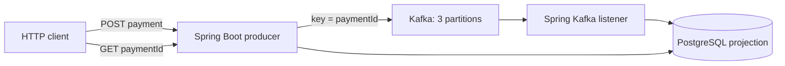

# Fintech Event Lab

A hands-on Java lab for understanding financial event processing through small, reviewable experiments.

The learning path covers Kafka, recovery and consistency, JVM performance, and observability. The domain is deliberately familiar: synthetic payment operations. No funds move and no payment provider is connected.

## Lesson 01: one event, one projection



The producer and consumer share one application for this first lesson. Kafka still separates publication from processing. The HTTP request does not insert a database row.

- `POST /api/payments` creates a synthetic `PaymentSubmitted` event and returns **202 only after Kafka acknowledges it**. The response includes the payment ID, partition and offset.
- `GET /api/payments/{paymentId}` reads PostgreSQL. It can return **404 before projection catches up**, or for an unknown ID. A 202 is not a settlement confirmation.
- Each payment has exactly one immutable event in this lesson. Re-delivering that event does not insert a second projection row.
- The consumer commits offsets after a successful listener invocation. PostgreSQL and the Kafka offset are **not one atomic transaction**. A crash between them can cause redelivery.
- A consumer error stops its listener rather than skipping the event. Restart the application after addressing the cause. The HTTP server may remain available while the listener is stopped.

Repeated HTTP submissions generate different payment IDs. Producer idempotence handles Kafka protocol retries; it does not provide HTTP/business idempotency. Status transitions, outbox and retry policies belong to later lessons.

## Versions

Direct runtime/build versions selected on 2026-11-05:

| Component | Version | Source |
| --- | --- | --- |
| Java | 27; local Temurin `27.0.1.0.2+1` | [Adoptium release](https://github.com/adoptium/temurin27-binaries/releases/tag/jdk-27.0.1.0.2%2B1) |
| Spring Boot | 4.1.2 | [Requirements and stable releases](https://docs.spring.io/spring-boot/system-requirements.html) |
| Apache Kafka broker | 4.4.0 | [Apache releases](https://downloads.apache.org/kafka/) |
| PostgreSQL | 18.6 | [Supported releases](https://www.postgresql.org/support/versioning/) |
| Maven Wrapper distribution | 3.10.0 | [Maven downloads](https://maven.apache.org/download.cgi) |

Spring libraries, the Kafka client, JDBC driver and Flyway follow the Spring Boot dependency BOM. Broker and client versions are distinct. Preview releases are not used. Java 27 is intentionally selected over an older LTS for this learning project.

## Run locally

Keep this repository in its own directory (for example, `learning/fintech-event-lab`) and run the commands below from that directory.

Requirements: JDK 27 and Docker with Compose. On this Mac, Compose is available as `docker-compose`; if your installation provides `docker compose`, use that equivalent command.

```sh
docker-compose up -d --wait
./scripts/mvn-local spring-boot:run
```

The helper uses the project-local JDK when available at `.tools/jdk/Contents/Home`, otherwise your `JAVA_HOME`. Maven downloads and dependencies stay in the ignored `.maven-home` directory. It supplies public-only Maven settings, so company mirrors and credentials from your user settings are not inherited. For another machine, install a JDK 27 and set `JAVA_HOME`; no project-local binary is committed.

The app listens on `127.0.0.1:18080`, Kafka on `127.0.0.1:19092`, and PostgreSQL on `127.0.0.1:15432`. Database `fintech_lab`, user `fintech_lab`, password `local_lab_only` are disposable local lab settings. Flyway creates the projection; Spring Kafka creates the topic.

When we agree to run the first experiment:

```sh
curl -i http://localhost:18080/api/payments \
  -H 'Content-Type: application/json' \
  -d '{"amount":125.50,"currency":"EUR"}'

# Replace PAYMENT_ID with the UUID returned above.
curl -i http://localhost:18080/api/payments/PAYMENT_ID

docker-compose exec kafka /opt/kafka/bin/kafka-consumer-groups.sh \
  --bootstrap-server kafka:9092 --describe --group payment-projection-v1
```

The simulation accepts positive amounts with at most 15 integer and 4 fractional digits, in EUR, USD or GBP. It does not implement settlement, currency-specific rounding or accounting balances.

Stop the app with Ctrl-C and infrastructure with `docker-compose down`. Named volumes retain events, offsets and projections. Kafka retention limits replay history; keeping a volume is not an unlimited event archive.

## Read the implementation

1. [PaymentController](src/main/java/io/github/jiog/fintech/payments/PaymentController.java): publish and await broker acknowledgement.
2. [KafkaConfiguration](src/main/java/io/github/jiog/fintech/payments/KafkaConfiguration.java): three partitions and explicit failure behavior.
3. [PaymentConsumer](src/main/java/io/github/jiog/fintech/payments/PaymentConsumer.java): deserialize and project.
4. [PaymentProjection](src/main/java/io/github/jiog/fintech/payments/PaymentProjection.java): one SQL statement, with redelivery tolerance.
5. [Application configuration](src/main/resources/application.yaml): producer guarantees and consumer offset policy.

[Learning plan and progress](docs/learning-plan.md) · [Lesson 01 discussion](docs/lessons/01-publication-and-projection.md)

Compilation without tests: `./scripts/mvn-local -Dmaven.test.skip=true package`.
Tests and failure/load experiments are run only when explicitly requested, following this repository's learning agreements.

Current validation: packaging succeeds on JDK 27 and Compose configuration parses. Application startup and the end-to-end flow have not yet been exercised; they are the next review/experiment step.
